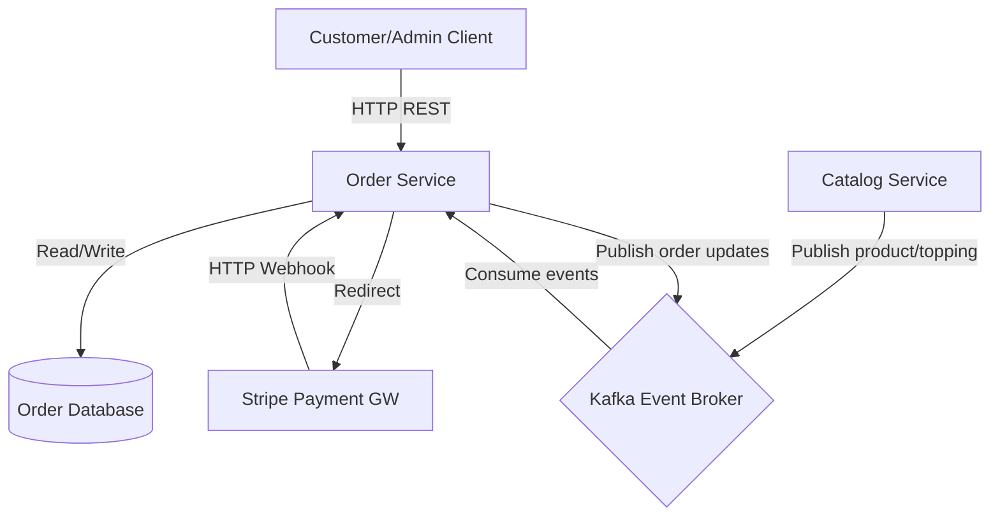
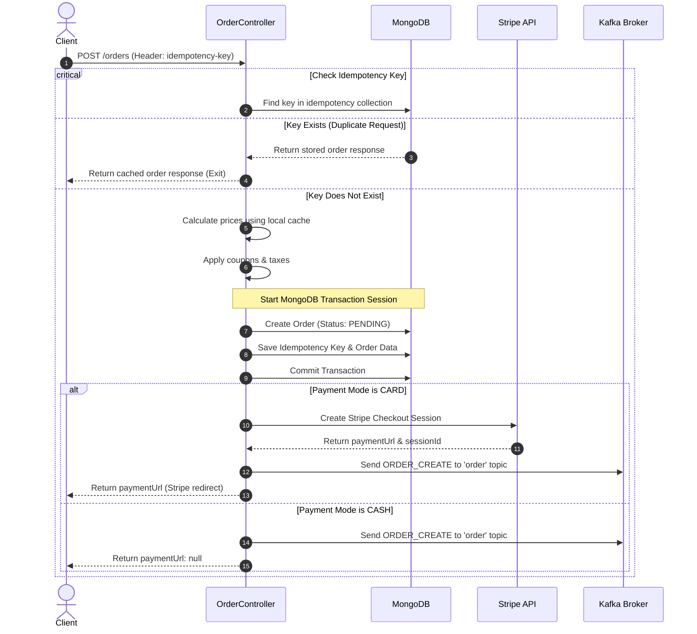
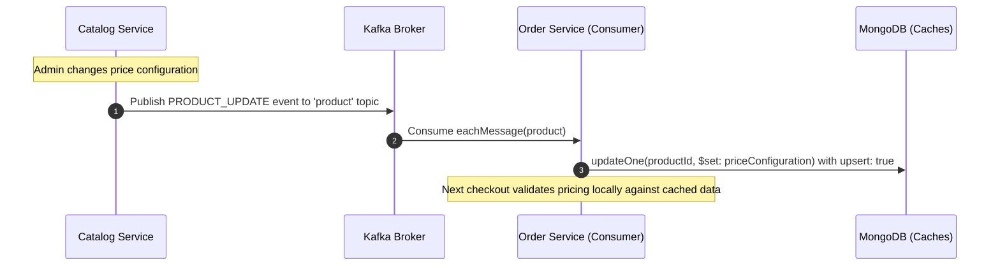

# Order Service Architecture Documentation

This document explains the structural designs, consistency pipelines, security constraints, and common runtime behaviors of the `mernspace-c-order-service`.

---

## 🛠️ System Overview & Communications

The Order Service is designed as an event-driven microservice using an asynchronous **Database-per-Service** pattern. It avoids synchronous HTTP lookups to the Catalog Service during critical checkouts by replicating product pricing configurations and topping costs locally using Kafka events.

---

## 🔒 Security & RBAC Matrix

Authentication is handled via JWT bearer tokens validated against an asymmetric JSON Web Key Set (JWKS) endpoint provided by the Auth Service. Below is the Route Permission Matrix:

| Route Path | HTTP Method | Allowed Roles | Description / Details |
| --- | --- | --- | --- |
| `/customer/` | `GET` | All Authenticated | Retrieves current user's customer profile or creates one if it doesn't exist. |
| `/customer/addresses/:id` | `PATCH` | All Authenticated | Adds an address text to the customer's profile addresses array. |
| `/coupons/` | `POST` | `admin`, `manager` | Creates a new discount coupon. (Managers should only create coupons for their own tenant). |
| `/coupons/verify` | `POST` | All Authenticated | Validates a coupon's presence, tenant association, and checks validity date. |
| `/orders/` | `POST` | All Authenticated | Creates a new order, calculates totals, creates Stripe session, and publishes `ORDER_CREATE`. |
| `/orders/` | `GET` | `admin`, `manager` | Admins retrieve all orders; Managers retrieve only their tenant's orders. Customers get `403 Forbidden`. |
| `/orders/mine` | `GET` | `customer` | Retrieves the list of orders belonging to the customer's resolved `customerId` (hides detailed cart). |
| `/orders/:orderId` | `GET` | `admin`, `manager`, `customer` | Admins can view any order; Managers can view their tenant's orders; Customers can view only their own orders. |
| `/orders/change-status/:orderId`| `PATCH`| `admin`, `manager` | Modifies `orderStatus` and publishes `ORDER_STATUS_UPDATE` Kafka event. |
| `/payments/webhook` | `POST` | Public (Stripe) | Stripe webhook receiver to complete order payment status updates. |

---

## 🛡️ Idempotency Flow (POST `/orders`)

To prevent duplicate charges or orders due to network retries, clients must send an `idempotency-key` in the request headers. The service coordinates a MongoDB session transaction to store the key and the created order atomically.

---

## 🔄 Catalog Replication Sync (Asynchronous Consistency)

Rather than query the Catalog Service synchronously during checkout, the Order Service subscribes to catalog updates via Kafka.

---

## ⚠️ Pitfalls, Edge Cases & Troubleshooting

### 1. Catalog Cache Desynchronization (Cold Start / Lost Events)
- **Problem**: If the Order Service is down when a new product is added in the Catalog Service, it may miss the Kafka event, resulting in a cache miss during checkout.
- **Impact**: In `calculateTotal`, if a product or topping does not exist in the local cache, the system fallback relies on cart client pricing or may fail.
- **Solution**: Implement a catalog reconciliation cron script or sync endpoint to fetch and warm up the local caches directly from the Catalog API on startup.

### 2. Stripe Webhook Failure (Unhandled Statuses)
- **Problem**: If a customer completes a card payment on Stripe, but the webhook delivery to `/payments/webhook` fails (due to network timeout, service restart, or configuration error), the order stays `paymentStatus: PENDING`.
- **Impact**: The order is never flagged as `PAID`, blocking downstream preparation or delivery workflows.
- **Solution**: Set up a retry-aware Stripe webhook endpoint, and run a daily cron that retrieves `checkout.sessions` directly from Stripe for all pending orders older than 2 hours.

### 3. MongoDB Transaction Errors (Replica Set Dependency)
- **Problem**: Mongoose transactions (`session.startTransaction()`) fail with `Transaction numbers are only allowed on a replica set member or mongos`.
- **Impact**: The database throws a 500 error on checkout, preventing cash or card orders.
- **Solution**: For local development, MongoDB must be configured to run as a single-node replica set rather than a standalone standalone instance.
